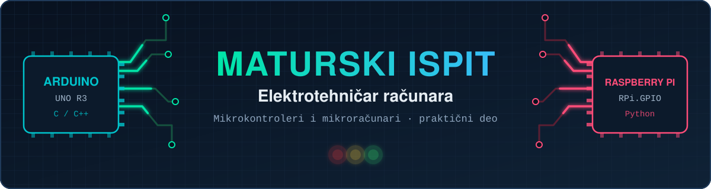
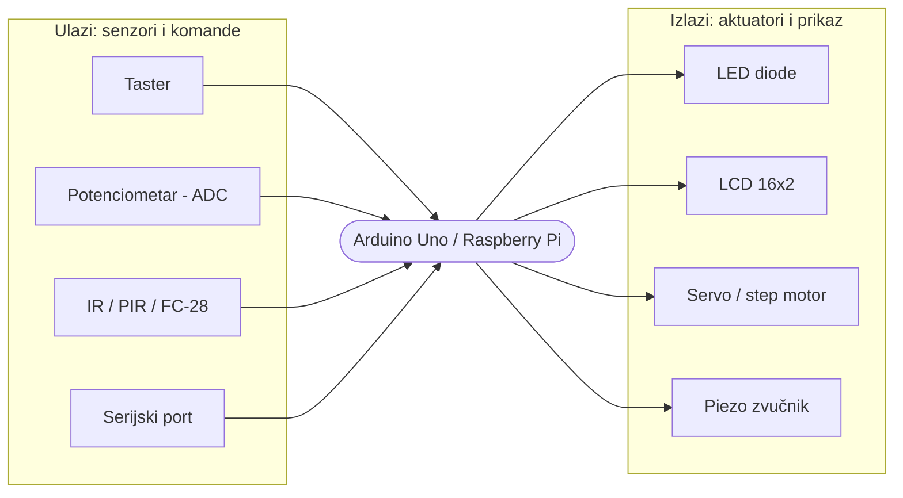
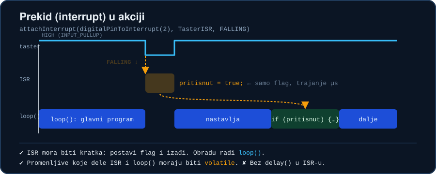
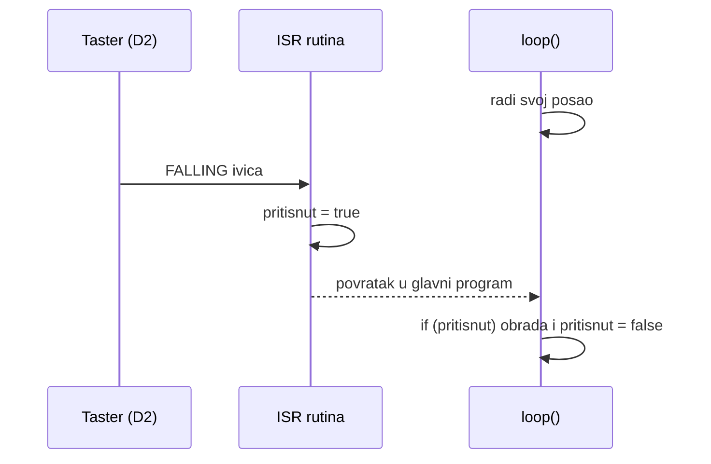
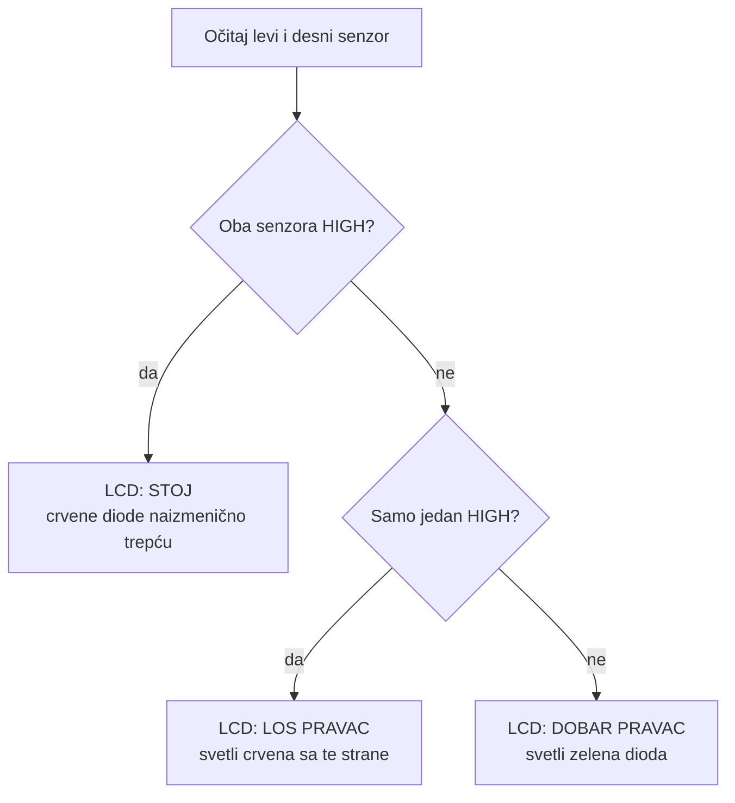
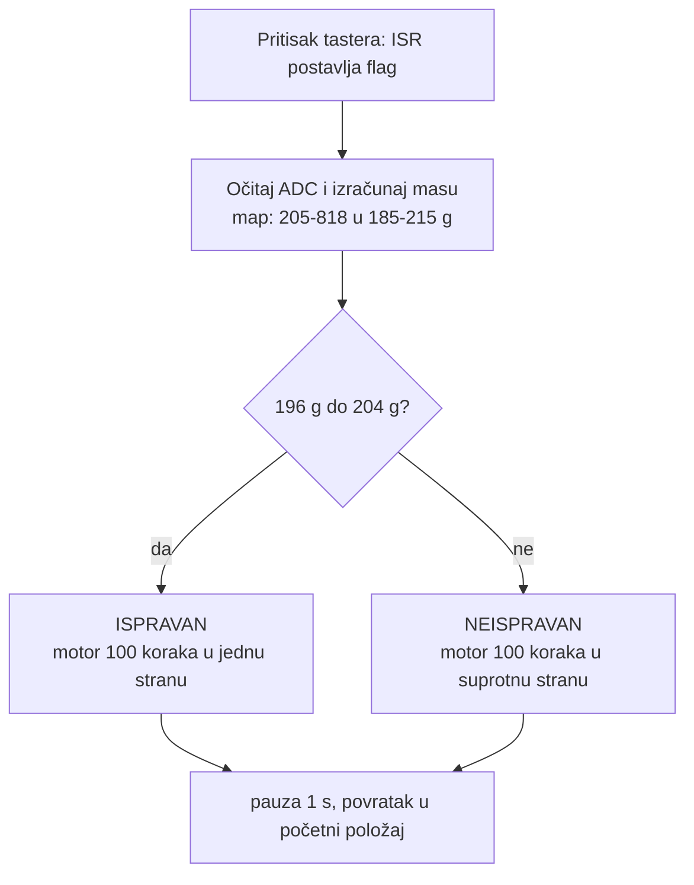

<div align="center">



<a href="https://github.com/MIhajloS07/Elektrotehnicar-Racunara-maturski-ispit-mikrokontroleri-i-mikroracunari">
  
</a>

<br>


[](LICENSE)


<p>
  <b>Rešenja praktičnog dela maturskog ispita iz predmeta <i>Mikrokontroleri i mikroračunari</i></b><br>
  za obrazovni profil <b>Elektrotehničar računara</b> – sa kodom, električnim šemama i objašnjenjima.
</p>

[**Zadaci**](#zadaci) · [**Brzi start**](#brzi-start) · [**Teorija**](#teorija) · [**Šeme i pinovi**](#sema-i-pinovi) · [**Saveti za ispit**](#saveti) · [**Česta pitanja**](#faq)

</div>


<a id="sadrzaj"></a>
## Sadržaj

1. [O projektu](#o-projektu)
2. [Pregled zadataka](#zadaci)
3. [Brzi start](#brzi-start)
4. [Potrebna oprema](#oprema)
5. [Teorija na jednom mestu](#teorija)
6. [Zadaci detaljno (šeme, pinovi, logika)](#detalji)
7. [Arduino vs Raspberry Pi](#poredjenje)
8. [Podsetnik: najčešće funkcije](#cheatsheet)
9. [Saveti za ispit i česte greške](#saveti)
10. [Beleške iz pregleda koda i ideje za unapređenje](#beleske)
11. [Česta pitanja](#faq)
12. [Struktura repozitorijuma](#struktura)
13. [Doprinos, licenca i autor](#autor)


<a id="o-projektu"></a>
## O projektu

Ovaj repozitorijum sadrži **moja rešenja zadataka sa maturskog ispita** iz praktičnog dela predmeta *Mikrokontroleri i mikroračunari*. Namenjen je učenicima **četvrtog razreda smera Elektrotehničar računara** u elektrotehničkim i tehničkim školama u Srbiji, kao **referenca za spremanje ispita**.

Zadaci se rade na dve platforme:

| Platforma | Uloga | Jezik i alat |
|---|---|---|
| **Arduino Uno** (ATmega328P) | Mikrokontroler – direktan rad sa pinovima, ADC-om, prekidima i tajmerima | C/C++ u **Arduino IDE** |
| **Raspberry Pi** (šeme rađene za Pi 3) | Mikroračunar sa Linuxom – rad sa GPIO pinovima iz Pythona | Python 3 u **Thonny** na **Raspberry Pi OS** |

Svaki zadatak ima sopstveni folder sa **programom** i **slikom električne šeme** (Fritzing prikaz sa ugrađenim šematskim prikazom).

> [!NOTE]
> Oznaka `4ETR-B##` označava zadatak (ispitnu kartu) broj `##` za 4. razred smera ETR. Nazivi zadataka u ovom README-u su **opisni** (napisani prema onome što program radi), a ne doslovni naslovi sa ispita.

> [!IMPORTANT]
> Prikazana rešenja su **jedna od mogućih implementacija**. Koristi ih da razumeš *zašto* nešto radi, a ne da bi ih prepisao. Na odbrani se traži da objasniš svaku liniju koda i svaku žicu na šemi.

Fokus pri izradi bio je na:

- **čitljivosti i modularnosti koda** (konstante za pinove, jasni komentari na srpskom)
- **pravilnoj upotrebi programskih struktura** (prekidi umesto stalnog ispitivanja gde je to moguće, `volatile` za deljene promenljive)
- **dobrim praksama u embedded programiranju** (pull-up otpornici, kratke ISR rutine, čišćenje GPIO-a na kraju)
- **proširenju osnovnih zahteva** (npr. zaštita od prekoračenja duty cycle-a, histereza kod termostata)

### Opšta arhitektura svih zadataka

Svaki zadatak, bez obzira na platformu, prati isti obrazac: **ulaz → obrada → izlaz**.




<a id="zadaci"></a>
## Pregled zadataka

| # | Zadatak | Platforma | Šta radi (ukratko) | Ključni pojmovi |
|:-:|---|:-:|---|---|
| [**B6**](#b6) | LED diode i PWM | 🍓 Pi | Tri LED naizmenično svetle, dva tastera menjaju jačinu u koracima od 10% | `GPIO.PWM`, event detect, pull-up |
| [**B12**](#b12) | Bacanje kocke | 🍓 Pi | Taster baca kocku, rezultat na LCD-u, šestica daje novo bacanje | LCD, `random`, callback |
| [**B20**](#b20) | Provera pravca | 🔵 Uno | Dva IR senzora linije, LCD poruka i signalizacija LED diodama | digitalni ulazi, LCD |
| [**B21**](#b21) | Termostat | 🔵 Uno | Merenje temperature, upravljanje grejačem i ventilatorom sa histerezom | ADC, `Timer1`, Serial |
| [**B22**](#b22) | Kontrola proizvoda | 🔵 Uno | Merenje mase, ISPRAVAN/NEISPRAVAN, step motor kao skretnica | prekid, ADC, `map`, Stepper |
| [**B24**](#b24) | Vlažnost zemljišta | 🔵 Uno | Senzor FC-28, ispis stanja na LCD-u, servo reaguje na suvo zemljište | ADC, Servo, LCD |
| [**B26**](#b26) | Bacanje kocke | 🔵 Uno | Isto kao B12, ali na Arduinu | prekid, LCD, `random` |
| [**B27**](#b27) | Alarm | 🔵 Uno | PIR senzor pokreće sirenu i crvenu LED, broji aktivacije | prekid, `tone`, Serial |
| [**B28**](#b28) | Step motor | 🔵 Uno | Taster uključuje/isključuje motor, potenciometar zadaje brzinu 20–100% | prekid, `Timer1`, ADC |
| [**B30**](#b30) | Serijske komande | 🔵 Uno | Komande `#CRVENA`, `#ZELENA`, `#UVECAJ`, `#SMANJI` upravljaju trepćućom LED | `Serial`, `String` |

### Mapa pojmova: šta se gde uvežbava

| Zadatak | Digitalni I/O | ADC | PWM / ton | Prekidi | Tajmer | Serijska | LCD | Motor |
|---|:-:|:-:|:-:|:-:|:-:|:-:|:-:|:-:|
| **B6** | ✅ | · | ✅ | ✅ | · | · | · | · |
| **B12** | ✅ | · | · | ✅ | · | · | ✅ | · |
| **B20** | ✅ | · | · | · | · | · | ✅ | · |
| **B21** | ✅ | ✅ | · | · | ✅ | ✅ | · | · |
| **B22** | ✅ | ✅ | · | ✅ | · | ✅ | · | ✅ |
| **B24** | · | ✅ | ✅ | · | · | · | ✅ | ✅ |
| **B26** | ✅ | · | · | ✅ | · | · | ✅ | · |
| **B27** | ✅ | · | ✅ | ✅ | · | ✅ | · | · |
| **B28** | ✅ | ✅ | · | ✅ | ✅ | ✅ | · | ✅ |
| **B30** | ✅ | · | · | · | · | ✅ | · | · |


<a id="brzi-start"></a>
## Brzi start

### 1. Preuzmi repozitorijum

```bash
git clone https://github.com/MIhajloS07/Elektrotehnicar-Racunara-maturski-ispit-mikrokontroleri-i-mikroracunari.git
cd Elektrotehnicar-Racunara-maturski-ispit-mikrokontroleri-i-mikroracunari
```

### 2A. Arduino zadaci (B20, B21, B22, B24, B26, B27, B28, B30)

1. Instaliraj **[Arduino IDE](https://www.arduino.cc/en/software)**.
2. Otvori `.ino` fajl iz odgovarajućeg foldera, npr. `4ETR-B21/4ETR-B21-program/4ETR-B21-program.ino`.
   > `.ino` fajl **mora** biti u folderu istog imena (`4ETR-B21-program/`), inače IDE traži da ga premesti.
3. **Alati → Board → Arduino Uno**, zatim izaberi **Port** na koji je priključen Uno.
4. Instaliraj biblioteku ako je potrebna (**Alati → Manage Libraries…**):

   | Biblioteka | Zadaci | Napomena |
   |---|---|---|
   | `LiquidCrystal` | B20, B24, B26 | ugrađena u IDE |
   | `Servo` | B24 | ugrađena u IDE |
   | `Stepper` | B22, B28 | ugrađena u IDE |
   | **`TimerOne`** | B21, B28 | **instalirati ručno** (autor: Paul Stoffregen) |

5. Klikni **Upload** (→). Za zadatke sa ispisom otvori **Serial Monitor** i postavi brzinu **9600 baud**.
6. **B30:** u Serial Monitoru postavi kraj reda na **Newline** (ili *Both NL & CR*), program radi `trim()` pa oba rade.

### 2B. Raspberry Pi zadaci (B6, B12)

1. Na Raspberry Pi OS otvori **Thonny** (*Programming → Thonny Python IDE*).
2. Otvori `4ETR-B6/4ETR-B6-program.py` ili `4ETR-B12/4ETR-B12-program.py`.
3. Pokreni sa **Run → Run current script** (`F5`). Dugme **Stop** prekida program, a `except KeyboardInterrupt` blok oslobađa GPIO pinove.
4. Za **B12** je potrebna biblioteka za LCD:

   ```bash
   pip3 install Adafruit_CharLCD
   # na novijim verzijama Raspberry Pi OS (Bookworm) pip traži dodatnu opciju:
   pip3 install Adafruit_CharLCD --break-system-packages
   ```

   `RPi.GPIO` je već instaliran na Raspberry Pi OS. Ako nije: `sudo apt install python3-rpi.gpio`.

Ili iz terminala:

```bash
python3 4ETR-B6/4ETR-B6-program.py
```

> [!WARNING]
> **Raspberry Pi 5** ne podržava klasičan `RPi.GPIO`. Za njega koristi kompatibilni paket `rpi-lgpio` (`sudo apt install python3-rpi-lgpio`). Biblioteka `Adafruit_CharLCD` je zastarela i na novijim modelima može tražiti dodatna podešavanja. Šeme i programi u ovom repozitorijumu rađeni su za **Raspberry Pi 3**.


<a id="oprema"></a>
## Potrebna oprema

| Komponenta | Zadaci | Napomena |
|---|---|---|
| Arduino Uno R3 + USB kabl | B20–B30 | |
| Raspberry Pi 3 + napajanje, SD kartica sa Raspberry Pi OS | B6, B12 | |
| Breadboard i žice (M-M, M-F) | svi | |
| LED diode (crvena, žuta, zelena) | B6, B20, B21, B27, B30 | |
| Otpornici **220 Ω** | zadaci sa LED | ograničenje struje LED diode |
| Otpornici **10 kΩ** (i **1 kΩ**) | B12, B26, B6 | pull-up taster |
| Tasteri (tact switch) | B6, B12, B22, B26, B28 | |
| Potenciometar **10 kΩ** | B20, B21, B22, B24, B26, B28 | ADC ulaz ili kontrast LCD-a |
| LCD **1602A** (HD44780, 16x2) | B12, B20, B24, B26 | 4-bitni režim |
| IR senzor prepreke/linije **FC-51** (2 kom) | B20 | digitalni izlaz |
| Senzor vlažnosti zemljišta **FC-28** | B24 | analogni izlaz |
| Servo motor (npr. SG90) | B24 | |
| Step motor **28BYJ-48** + drajver **ULN2003** | B22, B28 | 2048 koraka po obrtaju |
| PIR senzor pokreta | B27 | |
| Piezo zvučnik | B27 | |


<a id="teorija"></a>
## Teorija na jednom mestu

### GPIO, digitalni ulaz i pull-up otpornici

Pin koji nije ničim povezan „pluta” i čita nasumične vrednosti. Zato taster uvek ide uz **pull-up** (ili pull-down) otpornik koji definiše stanje kada taster nije pritisnut.

| | Pull-up | Pull-down |
|---|---|---|
| Taster nije pritisnut | pin = **HIGH** | pin = **LOW** |
| Taster je pritisnut | pin = **LOW** | pin = **HIGH** |
| Aktivna ivica | **FALLING** | RISING |
| Arduino | `INPUT_PULLUP` (interni, oko 20 kΩ) ili spoljašnji 10 kΩ | spoljašnji otpornik |
| Raspberry Pi | `GPIO.PUD_UP` | `GPIO.PUD_DOWN` |

Zato u ovim rešenjima prekidi koriste `FALLING`: pritisak tastera spušta pin na masu.

### Prekidi (interrupt)

Prekid omogućava da procesor **odmah** reaguje na događaj (npr. pritisak tastera), bez stalnog ispitivanja stanja u petlji.

<div align="center">

</div>



**Pravila za ISR:**
- mora biti **kratka**: samo postavi flag ili uvećaj brojač
- **bez `delay()`** i bez dugih ispisa
- promenljive koje deli sa `loop()` moraju biti **`volatile`**
- na Uno-u spoljašnje prekide podržavaju samo pinovi **D2** i **D3**

Na Raspberry Pi-ju isto radi `GPIO.add_event_detect(pin, GPIO.FALLING, callback=f, bouncetime=300)`. Parametar `bouncetime` ignoriše **treperenje kontakata** (debounce).

### A/D konverzija (ADC)

Arduino Uno ima **10-bitni** ADC: napon **0–5 V** se pretvara u broj **0–1023**.

```
U [V] = ADVrednost × 5.0 / 1023
```

Funkcija `map(x, in_min, in_max, out_min, out_max)` linearno preslikava opseg, npr. u B22 se ADC opseg 205–818 preslikava u masu 185–215 g.

> Raspberry Pi **nema** ADC. Za analogne senzore bi bio potreban spoljašnji čip (npr. MCP3008).

### PWM (Pulse Width Modulation)

PWM brzim uključivanjem i isključivanjem dobija „analogni” efekat: **prosečan napon = duty cycle × Vcc**. Oko je preslabo da vidi treperenje na 1 kHz, pa vidi samo promenu svetline.

<div align="center">

</div>

- **Raspberry Pi** (softverski PWM): `GPIO.PWM(pin, 1000)` pa `ChangeDutyCycle(0–100)`
- **Arduino**: `analogWrite(pin, 0–255)` na pinovima označenim sa **~** (3, 5, 6, 9, 10, 11)
- PWM signal koristi i **servo** (biblioteka `Servo` pravi odgovarajuće impulse) i `tone()` za zvučnik

### Tajmeri

`TimerOne` poziva funkciju na tačno određen period, nezavisno od `loop()`. U B21 se tako uzima merenje na svakih 200 ms, a u B28 se ispisuje brzina na svakih 500 ms.

```cpp
Timer1.initialize(200000);          // period u mikrosekundama (200 ms)
Timer1.attachInterrupt(TimerISR);   // funkcija koja se poziva na svaki period
```

### Serijska komunikacija (UART)

`Serial.begin(9600)` pokreće komunikaciju sa računarom preko USB-a. `Serial.print` šalje podatke, `Serial.readString()` čita komande. Brzina u Serial Monitoru mora da se poklapa sa onom u kodu.

### LCD 1602A (HD44780)

Displej 16 kolona × 2 reda. U **4-bitnom režimu** koristi se 6 signalnih pinova: `RS`, `E` (Enable) i `D4–D7`. Kontrast se podešava **potenciometrom 10 kΩ** na pinu `V0`.

| Arduino | Raspberry Pi |
|---|---|
| `LiquidCrystal lcd(RS, E, D4, D5, D6, D7)` | `LCD.Adafruit_CharLCD(rs, en, d4, d5, d6, d7, kolone, redovi, backlight)` |
| `lcd.begin(16, 2)` | automatski pri kreiranju objekta |
| `lcd.print("tekst")` | `lcd.message("tekst")` |
| `lcd.setCursor(0, 1)` | koristi se `"\n"` u poruci |
| `lcd.scrollDisplayRight()` | `lcd.move_right()` |

### Motori

| Motor | Biblioteka | Napomena |
|---|---|---|
| **Servo** | `Servo.h` | `attach(pin)`, `write(ugao 0–180)` |
| **Step motor 28BYJ-48 + ULN2003** | `Stepper.h` | 2048 koraka po obrtaju, `setSpeed(o/min)`, `step(±n)`; **redosled pinova je `IN1, IN3, IN2, IN4`** |

Step motor se **ne priključuje direktno** na Arduino, već preko ULN2003 drajvera koji može da isporuči potrebnu struju.

### Zašto otpornik uz LED?

LED nema unutrašnje ograničenje struje. Otpornik se računa po `R = (Vcc − Vf) / I`. Za crvenu LED (Vf ≈ 2 V) na 5 V i oko 15 mA dobija se oko 200 Ω, pa se uzima prva standardna vrednost: **220 Ω**.


<a id="detalji"></a>
## Zadaci detaljno

> Klikni na zadatak da ga otvoriš. Za svaki su navedeni **pinovi**, **logika** i **električna šema**.
> Raspberry Pi zadaci koriste **BCM numeraciju** pinova (GPIO brojevi, ne fizički brojevi).

<a id="b6"></a>
<details>
<summary><b>🍓 B6 · LED diode i PWM regulacija svetline</b> (Raspberry Pi · Python)</summary>

<br>

**Zadatak (po kodu):** tri LED diode (crvena, žuta, zelena) naizmenično svetle po 0,3 s. Jačina svetla se zadaje PWM-om, a dva tastera je povećavaju i smanjuju u koracima od 10%.

| Element | GPIO (BCM) | Napomena |
|---|:-:|---|
| Crvena LED | 17 | izlaz + PWM 1 kHz |
| Žuta LED | 27 | izlaz + PWM 1 kHz |
| Zelena LED | 22 | izlaz + PWM 1 kHz |
| Taster „uvećaj” | 5 | ulaz, `PUD_UP`, prekid `FALLING` |
| Taster „smanji” | 6 | ulaz, `PUD_UP`, prekid `FALLING` |

**Kako radi**
- `duty` je globalna promenljiva (početno 0, LED ne svetle).
- Callback funkcije `uvecajCallback` i `smanjiCallback` menjaju `duty` za ±10 i ograničavaju ga na **0–100%** (uz poruku kada se pređe granica).
- Glavna petlja u krug aktivira jednu po jednu LED sa trenutnim `duty` vrednošću, a ostale gasi.
- `bouncetime=300` ms štiti od treperenja tastera.
- Na `Ctrl+C` poziva se `GPIO.cleanup()`.

**Pojmovi:** `GPIO.PWM`, `ChangeDutyCycle`, `add_event_detect`, `global`, debounce.

📄 [`4ETR-B6/4ETR-B6-program.py`](4ETR-B6/4ETR-B6-program.py)


</details>

<a id="b12"></a>
<details>
<summary><b>🍓 B12 · Bacanje kocke na LCD-u</b> (Raspberry Pi · Python)</summary>

<br>

**Zadatak (po kodu):** pozdravna poruka „Dobro dosli” klizi desno pa levo, zatim se ispisuje „Baci kocku”. Svaki pritisak tastera daje nasumičan broj 1–6 uz redni broj bacanja. Šestica ispisuje i „Ponovite bacanje”.

| Element | GPIO (BCM) |
|---|:-:|
| Taster (`PUD_UP`, prekid `FALLING`) | 6 |
| LCD `RS` | 22 |
| LCD `E` | 17 |
| LCD `D4` / `D5` / `D6` / `D7` | 25 / 24 / 23 / 18 |
| LCD pozadinsko osvetljenje | 2 |

**Kako radi**
- Callback postavlja flag `baci = True` i briše ekran.
- Glavna petlja proverava flag, generiše `random.randint(1, 6)`, uvećava brojač i ispisuje rezultat.
- Pozdravna animacija koristi `lcd.move_right()` i `lcd.move_left()` po 6 puta.

**Pojmovi:** `Adafruit_CharLCD`, `random.randint`, callback + flag obrazac.

📄 [`4ETR-B12/4ETR-B12-program.py`](4ETR-B12/4ETR-B12-program.py)


</details>

<a id="b20"></a>
<details>
<summary><b>🔵 B20 · Provera pravca kretanja (IR senzori linije)</b> (Arduino Uno · C++)</summary>

<br>

**Zadatak (po kodu):** dva IR senzora (FC-51) prate liniju. LCD i LED diode prikazuju da li je pravac dobar.

| Element | Pin |
|---|:-:|
| Levi senzor | D3 |
| Desni senzor | D2 |
| Leva crvena LED | D0 |
| Desna crvena LED | D1 |
| Zelena LED | D12 |
| LCD `RS` / `E` | D10 / D11 |
| LCD `D4`–`D7` | D4, D5, D6, D7 |



**Napomena:** pinovi D0 i D1 su i `RX`/`TX` linije serijskog porta, pa mogu smetati pri učitavanju programa (privremeno skloni žicu) i ne mogu se koristiti zajedno sa `Serial`.

📄 [`4ETR-B20/4ETR-B20-program/4ETR-B20-program.ino`](4ETR-B20/4ETR-B20-program/4ETR-B20-program.ino)


</details>

<a id="b21"></a>
<details>
<summary><b>🔵 B21 · Termostat sa histerezom</b> (Arduino Uno · C++)</summary>

<br>

**Zadatak (po kodu):** potenciometar simulira temperaturni senzor. Grejač (crvena LED) i ventilator (zelena LED) rade po pragovima, a napon i temperatura se ispisuju u Serial Monitoru.

| Element | Pin |
|---|:-:|
| Potenciometar (senzor temperature) | A0 |
| Grejač (crvena LED) | D12 |
| Ventilator (zelena LED) | D11 |

**Formule iz zadatka:**

```
Napon       = ADVrednost × 5.0 / 1023
Temperatura = Napon / 0.05 − 10        →  opseg −10 … 90 °C
```

**Logika sa histerezom** (stanje se zadržava između pragova, pa nema treperenja oko granice):

| Temperatura | Grejač | Ventilator |
|---|:-:|:-:|
| **< 20 °C** | ✅ UKLJ | ❌ ISKLJ |
| **20 – 25 °C** | zadržava prethodno stanje | ❌ ISKLJ |
| **25 – 30 °C** | ❌ ISKLJ | zadržava prethodno stanje |
| **> 30 °C** | ❌ ISKLJ | ✅ UKLJ |

**Kako radi:** `Timer1` na svakih **200 ms** poziva `TimerISR` koji očitava ADC i računa napon i temperaturu. `loop()` ispisuje vrednosti i odlučuje o stanju grejača i ventilatora.

**Pojmovi:** `Timer1`, `volatile`, histereza, `analogRead`.

📄 [`4ETR-B21/4ETR-B21-program/4ETR-B21-program.ino`](4ETR-B21/4ETR-B21-program/4ETR-B21-program.ino)


</details>

<a id="b22"></a>
<details>
<summary><b>🔵 B22 · Kontrola ispravnosti proizvoda (masa + step motor)</b> (Arduino Uno · C++)</summary>

<br>

**Zadatak (po kodu):** na pritisak tastera meri se „masa proizvoda” (potenciometar kao vaga). Proizvod je **ispravan** ako je masa **196–204 g**. Step motor skreće proizvod na jednu ili drugu stranu.

| Element | Pin |
|---|:-:|
| Taster (`INPUT_PULLUP`, prekid `FALLING`) | D2 |
| Potenciometar (vaga) | A0 |
| ULN2003 `IN1` / `IN2` / `IN3` / `IN4` | D8 / D9 / D10 / D11 |



**Pojmovi:** `attachInterrupt`, `INPUT_PULLUP`, `map`, `Stepper` (2048 koraka, 15 o/min, redosled pinova `IN1, IN3, IN2, IN4`).

📄 [`4ETR-B22/4ETR-B22-program/4ETR-B22-program.ino`](4ETR-B22/4ETR-B22-program/4ETR-B22-program.ino)


</details>

<a id="b24"></a>
<details>
<summary><b>🔵 B24 · Nadzor vlažnosti zemljišta (servo + LCD)</b> (Arduino Uno · C++)</summary>

<br>

**Zadatak (po kodu):** senzor FC-28 meri vlažnost zemljišta. Veća vrednost znači **suvlje** zemljište.

| Očitavanje | Stanje | Reakcija |
|---|---|---|
| `< 287` | VLAZNA ZEMLJA | samo ispis |
| `287 – 800` | OPTIMALNA ZEMLJA | samo ispis |
| `> 800` | SUVA ZEMLJA! | servo se pomera na 30°, čeka 1 s, pa na 150° |

U drugom redu LCD-a uvek se ispisuje `Vlaznost: <vrednost>`. Merenje se ponavlja na svake **3 s**.

| Element | Pin |
|---|:-:|
| FC-28 (analogni izlaz) | A0 |
| Servo (PWM signal) | D3 |
| LCD `RS` / `E` / `D4`–`D7` | D10 / D11 / D4–D7 |

**Pojmovi:** `analogRead`, pragovi, `Servo.write`, `lcd.setCursor`.

📄 [`4ETR-B24/4ETR-B24-program/4ETR-B24-program.ino`](4ETR-B24/4ETR-B24-program/4ETR-B24-program.ino)


</details>

<a id="b26"></a>
<details>
<summary><b>🔵 B26 · Bacanje kocke (Arduino)</b> (Arduino Uno · C++)</summary>

<br>

**Isti zadatak kao B12**, ali na Arduinu: pozdravna poruka klizi desno pa levo, pritisak tastera baca kocku, šestica daje „Ponovite bacanje”.

| Element | Pin |
|---|:-:|
| Taster (spoljašnji **10 kΩ pull-up**, prekid `FALLING`) | D2 |
| LCD `RS` / `E` / `D4`–`D7` | D10 / D11 / D4–D7 |

**Razlike u odnosu na B12:** prekid hardverski (`attachInterrupt`), `random(1, 7)` (gornja granica je **isključena**), `lcd.scrollDisplayRight()` umesto `move_right()`.

> Za taster se u ovom zadatku koristi spoljašnji pull-up od 10 kΩ. Isti problem rešava i `INPUT_PULLUP` bez dodatnog otpornika.

📄 [`4ETR-B26/4ETR-B26-program/4ETR-B26-program.ino`](4ETR-B26/4ETR-B26-program/4ETR-B26-program.ino)


</details>

<a id="b27"></a>
<details>
<summary><b>🔵 B27 · Alarm sa PIR senzorom</b> (Arduino Uno · C++)</summary>

<br>

**Zadatak (po kodu):** PIR senzor detektuje pokret i izaziva prekid. Aktivira se crvena LED i sirena (naizmenični tonovi 2100/2200/2300 Hz, 15 ciklusa), a broj aktivacija se ispisuje u Serial Monitoru.

| Element | Pin |
|---|:-:|
| PIR senzor (prekid `RISING`) | D2 |
| Crvena LED | D12 |
| Piezo zvučnik | D8 |

**Ispis u Serial Monitoru**
- bez pokreta: `BEZBEDNO!`
- pri pokretu: `Upozorenje | broj pokretanja aktivacije: N`

**Pojmovi:** `RISING` prekid, `tone` / `noTone`, `volatile` brojač.

📄 [`4ETR-B27/4ETR-B27-program/4ETR-B27-program.ino`](4ETR-B27/4ETR-B27-program/4ETR-B27-program.ino)


</details>

<a id="b28"></a>
<details>
<summary><b>🔵 B28 · Regulacija brzine step motora</b> (Arduino Uno · C++)</summary>

<br>

**Zadatak (po kodu):** taster uključuje i isključuje step motor (toggle), potenciometar zadaje brzinu **20–100%**, a `Timer1` na svakih **0,5 s** ispisuje trenutnu brzinu.

| Element | Pin |
|---|:-:|
| Taster (`INPUT_PULLUP`, prekid `FALLING`) | D2 |
| Potenciometar (brzina) | A0 |
| ULN2003 `IN1` / `IN2` / `IN3` / `IN4` | D8 / D9 / D10 / D11 |

**Kako se dobija brzina:** motor pravi po **jedan korak** u `loop()`, a pauza između koraka se menja preko `map(ADVrednost, 0, 1023, 10, 2)` ms. Manja pauza znači veća brzina.

**Pojmovi:** toggle u prekidu (`ukljucen = !ukljucen`), `Timer1`, `map`, `Stepper.step(1)`.

📄 [`4ETR-B28/4ETR-B28-program/4ETR-B28-program.ino`](4ETR-B28/4ETR-B28-program/4ETR-B28-program.ino)


</details>

<a id="b30"></a>
<details>
<summary><b>🔵 B30 · Serijsko upravljanje LED diodama</b> (Arduino Uno · C++)</summary>

<br>

**Zadatak (po kodu):** komande koje šalješ preko Serial Monitora biraju koja LED trepće i koliko brzo.

| Komanda | Efekat |
|---|---|
| `#CRVENA` | trepće crvena LED (D12) |
| `#ZELENA` | trepće zelena LED (D11) |
| `#UVECAJ` | produžava period: 500 → 1000 → 1500 → 2000 ms |
| `#SMANJI` | skraćuje period: 2000 → 1500 → 1000 → 500 ms |
| bilo šta drugo | `Nepoznata naredba` |

Periodi su u nizu `periodeMs[]`, a promenljiva `periodaIndex` pamti trenutni. Na granicama program ispisuje „Ovo je maksimalna/minimalna perioda!”.

**Pojmovi:** `Serial.available()`, `readString()`, **`trim()`** (uklanja CR/NL sa kraja), poređenje `String` objekata.

📄 [`4ETR-B30/4ETR-B30-program/4ETR-B30-program.ino`](4ETR-B30/4ETR-B30-program/4ETR-B30-program.ino)


</details>


<a id="sema-i-pinovi"></a>
## Pinovi na jednom mestu

### Arduino Uno

| Pin | B20 | B21 | B22 | B24 | B26 | B27 | B28 | B30 |
|:-:|---|---|---|---|---|---|---|---|
| **D0** | LED leva (crv.) | | | | | | | |
| **D1** | LED desna (crv.) | | | | | | | |
| **D2** | senzor desni | | taster | | taster | PIR | taster | |
| **D3** | senzor levi | | | servo | | | | |
| **D4–D7** | LCD D4–D7 | | | LCD D4–D7 | LCD D4–D7 | | | |
| **D8** | | | ULN2003 IN1 | | | zvučnik | ULN2003 IN1 | |
| **D9** | | | ULN2003 IN2 | | | | ULN2003 IN2 | |
| **D10** | LCD RS | | ULN2003 IN3 | LCD RS | LCD RS | | ULN2003 IN3 | |
| **D11** | LCD E | LED zelena (vent.) | ULN2003 IN4 | LCD E | LCD E | | ULN2003 IN4 | LED zelena |
| **D12** | LED zelena | LED crvena (grejač) | | | | LED crvena | | LED crvena |
| **A0** | | potenciometar | potenciometar | FC-28 | | | potenciometar | |

### Raspberry Pi (BCM)

| GPIO | B6 | B12 |
|:-:|---|---|
| **2** | | LCD backlight |
| **5** | taster „uvećaj” | |
| **6** | taster „smanji” | taster |
| **17** | LED crvena | LCD E |
| **18** | | LCD D7 |
| **22** | LED zelena | LCD RS |
| **23** | | LCD D6 |
| **24** | | LCD D5 |
| **25** | | LCD D4 |
| **27** | LED žuta | |


<a id="poredjenje"></a>
## Arduino vs Raspberry Pi

| Osobina | 🔵 Arduino Uno | 🍓 Raspberry Pi |
|---|---|---|
| Tip | **Mikrokontroler** (ATmega328P) | **Mikroračunar** (SoC sa Linuxom) |
| Operativni sistem | nema, jedan program u petlji | Raspberry Pi OS (Linux) |
| Jezik u ovim zadacima | C/C++ | Python |
| Logički nivo pinova | **5 V** | **3,3 V** (5 V može oštetiti pin!) |
| Analogni ulazi (ADC) | ✅ 6 kanala, 10 bita | ❌ nema (potreban spoljašnji ADC) |
| PWM | hardverski (`analogWrite`) | softverski (`GPIO.PWM`) ili hardverski na određenim pinovima |
| Reakcija u realnom vremenu | ✅ deterministička, odlična | ograničena (OS može da prekine program) |
| Pokretanje | trenutno po uključenju | boot traje desetine sekundi |
| Pogodno za | senzore, aktuatore, precizno vreme | složenu logiku, mrežu, grafiku, fajlove |


<a id="cheatsheet"></a>
## Podsetnik: najčešće funkcije

<table>
<tr>
<th width="50%">🔵 Arduino (C++)</th>
<th width="50%">🍓 Raspberry Pi (Python)</th>
</tr>
<tr>
<td valign="top">

```cpp
pinMode(pin, OUTPUT);
pinMode(pin, INPUT_PULLUP);

digitalWrite(pin, HIGH);
int s = digitalRead(pin);

int adc = analogRead(A0);   // 0-1023
float u = adc * 5.0 / 1023;
analogWrite(pin, 128);      // PWM 0-255

int y = map(x, 0, 1023, 0, 100);

attachInterrupt(
  digitalPinToInterrupt(2),
  isr, FALLING);

Timer1.initialize(200000);  // us
Timer1.attachInterrupt(isr);

Serial.begin(9600);
Serial.println("tekst");

tone(pin, 2000);  noTone(pin);
delay(500);
```

</td>
<td valign="top">

```python
import RPi.GPIO as GPIO
from time import sleep

GPIO.setmode(GPIO.BCM)
GPIO.setup(pin, GPIO.OUT)
GPIO.setup(pin, GPIO.IN,
           pull_up_down=GPIO.PUD_UP)

GPIO.output(pin, GPIO.HIGH)
s = GPIO.input(pin)

pwm = GPIO.PWM(pin, 1000)  # Hz
pwm.start(0)
pwm.ChangeDutyCycle(50)    # 0-100
pwm.stop()

GPIO.add_event_detect(
    pin, GPIO.FALLING,
    callback=f, bouncetime=300)

try:
    while True:
        ...
        sleep(0.5)
except KeyboardInterrupt:
    GPIO.cleanup()
```

</td>
</tr>
</table>


<a id="saveti"></a>
## Saveti za ispit i česte greške

### Plan rada na ispitu


1. **Ne počinji od koda.** Prvo napravi tabelu pinova (šta je na kom pinu), pa tek onda piši program.
2. **Poveži hardver pre testiranja koda**, uz proveru napajanja i mase (GND).
3. **Testiraj po delovima**: prvo da LED trepće, pa taster, pa tek onda cela logika.
4. **Koristi `Serial.println()`** (ili `print()` na Pi-ju) da vidiš vrednosti senzora i stanje promenljivih.
5. **Komentariši kod**: lakše objašnjavaš na odbrani, a i komisija vidi da razumeš.

### Najčešće greške

| Greška | Simptom | Rešenje |
|---|---|---|
| Zaboravljen `pinMode` | LED ne svetli ili slabo svetli | Podesi svaki pin u `setup()` |
| Taster bez pull-up/pull-down | Nasumično okidanje, „duhovi” | `INPUT_PULLUP` / `GPIO.PUD_UP` ili spoljašnji otpornik |
| Pogrešna aktivna ivica | Taster reaguje pri otpuštanju | Sa pull-up-om koristi `FALLING` |
| Promenljiva u ISR-u nije `volatile` | Kompajler „optimizuje” i flag se ne menja | `volatile boolean flag` |
| `delay()` u ISR-u | Program se zaglavi | ISR samo postavlja flag |
| Zaboravljen `trim()` pri čitanju komande | `#CRVENA` ne prepoznaje | `naredba.trim();` |
| Prekid na pinu koji ne podržava prekide | Ništa se ne dešava | Na Uno koristi D2 ili D3 |
| Pogrešan redosled pinova step motora | Motor vibrira, ne okreće se | `Stepper(korakaPoObr, IN1, IN3, IN2, IN4)` |
| LCD prikazuje kvadratiće ili ništa | Loš kontrast ili veza | Podesi potenciometar na `V0`, proveri `RS`, `E`, `D4–D7` |
| Mešanje BCM i BOARD numeracije | Pali se pogrešna LED na Pi-ju | `GPIO.setmode(GPIO.BCM)` i GPIO brojevi |
| Zaboravljen `GPIO.cleanup()` | Upozorenje „channel already in use” | Uvek u `except`/`finally` bloku |
| 5 V signal na Raspberry Pi pinu | Može da ošteti pin | Pi koristi **3,3 V** logiku |
| Serial brzina se ne poklapa | Ispis je nečitljiv | Isti baud u kodu i u Serial Monitoru (9600) |


<a id="beleske"></a>
## Beleške iz pregleda koda i ideje za unapređenje

Rešenja rade po zadatom opisu. Prilikom detaljnog pregleda uočeno je nekoliko sitnica koje je dobro znati (i koje se lako mogu pomenuti na odbrani kao „dalji razvoj”):

| Zadatak | Zapažanje | Moguće unapređenje |
|:-:|---|---|
| B6 | Nova vrednost `duty` se primeni tek pri sledećem koraku petlje (kašnjenje do 0,3 s) | Primeniti `duty` odmah u callback-u ili skratiti pauze |
| B12 | Callback poziva `lcd.clear()` iz niti prekida, dok glavna petlja takođe piše na LCD | Callback neka samo postavi flag, a LCD neka dira samo glavna petlja |
| B20 | Pinovi D0/D1 su `RX`/`TX` (smetaju pri upload-u i blokiraju `Serial`) | Prebaciti diode na slobodne pinove (npr. D8, D9) |
| B21 | `loop()` ispisuje bez pauze, pa Serial Monitor „pliva”; `float` deljen sa ISR-om se čita bez zaštite | Dodati `delay(200)` i čitati deljene vrednosti uz `noInterrupts()` / `interrupts()` |
| B26 | Bez `randomSeed()` kocka daje **isti niz** posle svakog resetovanja | `randomSeed(analogRead(A1));` u `setup()` sa nepovezanim analognim pinom |
| B27 | Posle tona od 2300 Hz nema `delay()`, pa taj ton traje samo trenutak; `BEZBEDNO!` se ispisuje u svakom prolazu petlje | Dodati `delay(100)` posle trećeg tona i ispisivati samo pri promeni stanja |
| B28 | `Serial.print` se poziva iz `Timer1` ISR-a, što se ne preporučuje | ISR postavlja flag, a ispis radi `loop()` |
| B30 | Pri prelasku sa jedne diode na drugu, prethodna dioda može ostati upaljena | Pre promene aktivne diode ugasiti obe diode |
| svi | Tasteri nemaju softversku zaštitu od treperenja u prekidu (osim B6 i B12) | Provera vremena `millis()` u ISR-u |

### Plan razvoja repozitorijuma

- [x] Kod i šeme za svih 10 zadataka
- [x] Detaljan README sa teorijom, pinovima i animacijama
- [ ] Kratki GIF/video demonstracije rada za svaki zadatak
- [ ] Wokwi simulacije (rad bez hardvera)
- [ ] Prepravljene verzije koda sa unapređenjima iz tabele iznad
- [ ] Zadaci sa ostalih ispitnih karata


<a id="faq"></a>
## Česta pitanja

<details>
<summary><b>Da li mogu da prepišem rešenje na ispitu?</b></summary>

<br>

Ne preporučuje se. Zadaci se razlikuju od godine do godine, a komisija traži objašnjenje svake linije i veze na šemi. Repozitorijum je pisan kao **materijal za učenje**: pročitaj logiku, razumi pojmove iz [teorije](#teorija), pa pokušaj da isti zadatak rešiš samostalno.

</details>

<details>
<summary><b>Zašto taster koristi <code>FALLING</code>, a ne <code>RISING</code>?</b></summary>

<br>

Taster je povezan sa pull-up otpornikom. Dok nije pritisnut, pin je `HIGH`. Pritiskom se pin spaja na masu i **pada** na `LOW`, što je opadajuća ivica (`FALLING`).

</details>

<details>
<summary><b>Zašto je <code>random(1, 7)</code>, a ne <code>random(1, 6)</code>?</b></summary>

<br>

Arduino `random(min, max)` vraća brojeve od `min` do `max − 1`. Za kocku 1–6 gornja granica je 7. U Pythonu `random.randint(1, 6)` uključuje **obe** granice.

</details>

<details>
<summary><b>Zašto servo / step motor ne radi kad ga povežem direktno?</b></summary>

<br>

Motori vuku više struje nego što pin Arduina može da isporuči. Step motor ide preko **ULN2003** drajvera, a veći servo motori traže odvojeno napajanje (uz zajedničku masu sa Arduinom).

</details>

<details>
<summary><b>Kako da testiram kod bez hardvera?</b></summary>

<br>

Za Arduino možeš koristiti simulatore kao što su **Wokwi** ili Tinkercad Circuits. Raspberry Pi GPIO se ne može lako simulirati, ali se logika Python programa može isprobati sa „lažnim” funkcijama za ulaz i izlaz.

</details>


<a id="struktura"></a>
## Struktura repozitorijuma

```text
Elektrotehnicar-Racunara-maturski-ispit-mikrokontroleri-i-mikroracunari/
├── assets/                          # animacije i slike za README
│   ├── banner.svg
│   ├── divider.svg
│   ├── pwm.svg
│   └── interrupt.svg
├── 4ETR-B6/                         # 🍓 Raspberry Pi
│   ├── 4ETR-B6-program.py
│   └── elektricna sema i raspberry pi sistem.png
├── 4ETR-B12/                        # 🍓 Raspberry Pi
│   ├── 4ETR-B12-program.py
│   └── elektricna sema i raspberry pi sistem.png
├── 4ETR-B20/                        # 🔵 Arduino
│   ├── 4ETR-B20-program/
│   │   └── 4ETR-B20-program.ino
│   └── elektricna sema i arduino sistem.png
├── 4ETR-B21/ … 4ETR-B30/            # isti raspored (B21, B22, B24, B26, B27, B28, B30)
├── .gitignore
├── LICENSE                          # MIT
└── README.md
```


<a id="autor"></a>
## Doprinos, licenca i autor

### Doprinos

Našao si grešku ili imaš bolje rešenje? **Pull request-ovi i issue-i su dobrodošli.**

1. Napravi *fork* repozitorijuma
2. Napravi granu: `git checkout -b dopuna/B##`
3. Dodaj kod i šemu u folder `4ETR-B##`
4. Otvori *Pull Request* sa kratkim opisom

### Licenca

Projekat je pod **[MIT licencom](LICENSE)**: slobodno koristi, menjaj i deli uz navođenje autora.

### Autor

<table>
<tr>
<td align="center">
  <a href="https://github.com/MIhajloS07">
    <br>
    <b>Mihajlo Stoiljković</b>
  </a><br>
  <sub>Elektrotehničar računara</sub>
</td>
</tr>
</table>

<div align="center">

**Ako ti je repozitorijum pomogao u spremanju ispita, ostavi ⭐ i podeli ga drugarima!**

Srećno na maturskom! 🎓


</div>
